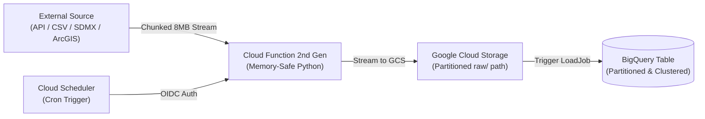

# BigQuery Public Data Ingestion Skill 🚀

[](https://antigravity.google)
[](https://cloud.google.com)
[](https://python.org)
[](LICENSE)

An agentic AI skill for [Google Antigravity](https://antigravity.google) and compatible AI coding assistants that automatically scaffolds, implements, and deploys production-grade GCP data pipelines to ingest external public datasets into **Google BigQuery**.

---

## 📖 Background

While Google Cloud maintains a large catalog under `bigquery-public-data`, many mission-critical macro, energy, geopolitical, and maritime datasets are **not natively hosted** in BigQuery.

This skill equips your AI assistant with:
1. **A Technical Catalog** pre-mapped with endpoints, auth rules, schemas, and schedules for 15+ global data sources.
2. **Production GCP Architectural Standards** (memory-safe streaming, zero-cost atomic `LoadJob`s, day-partitioning, and Secret Manager integration).
3. **Turnkey Templates** for 4 ingestion archetypes (Direct URL, REST API, SDMX, and Zipped Archives).
4. **Automated Deployment Generators** producing ready-to-run `gcloud` deploy and Cloud Scheduler commands.

---

## 🏗️ Architecture



### Key Engineering Guardrails
* **Memory-Safe Chunked Streaming:** Datasets are streamed via HTTP directly to GCS using `blob.open("wb")` in 8MB chunks, completely preventing out-of-memory errors on large multi-gigabyte files.
* **Atomic BigQuery Loads:** Replaces expensive and fragile streaming inserts with native BigQuery `LoadJob`s (`load_table_from_uri`) for transactional, zero-cost loading.
* **Smart Partitioning & Idempotent Deduplication:** Snapshot lists (OFAC, CISA KEV) default to `WRITE_TRUNCATE`; incremental time-series (PortWatch, AGSI+, Weather) default to `WRITE_APPEND` partitioned by observation date, paired with post-load idempotent deduplication on `(date, entity_id)` keeping the latest `_ingested_at` timestamp so rolling lookback windows (`days=14`) never create duplicate rows.
* **Secure Secrets:** API tokens are managed via Google Secret Manager and injected at runtime.

---

## 📊 Pre-Mapped Data Sources Catalog

The skill includes pre-mapped ingestion blueprints in [`references/data_sources_catalog.md`](references/data_sources_catalog.md):

| Data Source | Category | Archetype | Native Format | Update Cadence |
| :--- | :--- | :--- | :--- | :--- |
| **UN Comtrade** | Global Trade Flows | Archive ZIP / API | Zipped CSV | Monthly / Annual |
| **IMF PortWatch** | Maritime Trade & Chokepoints | REST / GeoJSON | ArcGIS FeatureServer / CSV | Daily check (15:00 UTC) |
| **JODI** | Oil & Gas Production/Flows | Bulk File | Zipped CSV | Monthly |
| **U.S. EIA** | Energy & Petroleum Stats | REST API v2 / Bulk | JSON / Manifest ZIP | Weekly / Monthly |
| **GIE AGSI+** | European Gas Storage | REST API | JSON | Daily (20:00 CET) |
| **Open-Meteo** | Weather & Climate Archive | REST / Parquet | JSON / Open Parquet | Hourly / Daily |
| **GDACS** | Global Disaster Alerts | GeoJSON Feed | GeoJSON | Every 30 mins |
| **NASA FIRMS** | Wildfire & Thermal Anomaly | REST API / CSV | CSV / GeoJSON | Daily / 6-hourly |
| **OFAC SDN** | Sanctions & Watchlists | Static Bulk | CSV / XML / JSON | Daily |
| **FATF Lists** | Anti-Money Laundering (AML) | Bulk Export | FollowTheMoney JSON / CSV | Daily / Weekly |
| **CISA KEV** | Exploited Cybersecurity CVEs | Static Bulk | CSV / JSON | Daily |
| **Central Banks (IMF, BIS, ECB, Eurostat)** | Macroeconomics & FX | SDMX REST | SDMX-CSV / SDMX-JSON | Daily / Monthly |
| **FAO Food Price Index**| Agricultural Commodities | Bulk File | CSV / Excel | Monthly |
| **UCDP** | Armed Conflict Events (GED) | Bulk CSV / REST | CSV | Quarterly / Annual |
| **OpenSky Network** | Live ADS-B Aviation States | REST / Parquet | JSON / Monthly Parquet | Hourly / Monthly |

---

## ⚡ Quickstart & Installation

You can install this skill either **globally** across your entire machine, or **locally** in a specific project workspace.

### Option 1: One-Line Install Script

Clone the repository and run the installer:

```bash
git clone https://github.com/catherhuang/bq-public-data-ingestion.git
cd bq-public-data-ingestion

# Install globally to ~/.gemini/config/skills/ (Default)
./install.sh --global

# OR install into your current Git project (.agents/skills/)
./install.sh --workspace
```

### Option 2: Direct Git Clone (Global)

```bash
git clone https://github.com/catherhuang/bq-public-data-ingestion.git \
  ~/.gemini/config/skills/bq-public-data-ingestion
```

### Option 3: Add as a Git Submodule (Project Workspace)

```bash
mkdir -p .agents/skills
git submodule add https://github.com/catherhuang/bq-public-data-ingestion.git \
  .agents/skills/bq-public-data-ingestion
```

---

## 🤖 How to Use with Antigravity

Once installed, simply prompt your agent to generate an ingestion pipeline for any dataset:

### Example Prompts:

* **Generate a REST API pipeline:**
  > *"Use the `bq-public-data-ingestion` skill to create the pipeline for **GIE AGSI+** European gas storage."*

* **Generate a Bulk File pipeline:**
  > *"Use the `bq-public-data-ingestion` skill to build the ingestion Cloud Function for **CISA KEV**."*

* **Batch Request:**
  > *"Scaffold BigQuery ingestion pipelines for **IMF, ECB, and BIS** using the `bq-public-data-ingestion` skill."*

The agent will automatically create:
* `main.py`: Cloud Function entrypoint with retry session, memory-efficient streaming, and idempotent deduplication.
* `requirements.txt`: Pinned, minimal dependencies.
* `schema.json`: Explicit BigQuery schema with descriptions, partition, and cluster fields.
* `deploy.sh`: Turnkey `gcloud functions deploy --gen2` and `gcloud scheduler jobs create/update` script.

---

## 📂 Repository Layout

```text
bq-public-data-ingestion/
├── SKILL.md                          # Antigravity skill definition & decision rules
├── README.md                         # Project documentation
├── LICENSE                           # Apache 2.0 License
├── install.sh                        # CLI installer script
├── references/
│   └── data_sources_catalog.md       # Full technical specifications for 15+ datasets
├── templates/
│   ├── direct_file_ingestion.py      # Archetype A: Static URL / Bulk File template
│   └── rest_api_ingestion.py         # Archetype B: Authenticated REST API template
└── examples/
    ├── imf_portwatch/                # Working reference implementation: IMF PortWatch
    │   ├── main.py                   # PortWatch ArcGIS FeatureServer extractor + deduplication
    │   ├── requirements.txt
    │   ├── schema_chokepoints.json   # 28 Maritime Chokepoints schema
    │   ├── schema_ports.json         # 2,000+ Global Ports activity schema
    │   ├── test_local.py             # Local test runner
    │   └── deploy.sh                 # Cloud Function 2nd Gen + Daily Cloud Scheduler (15:00 UTC)
    └── opensky_network/              # Working reference implementation: OpenSky ADS-B
        ├── main.py                   # OpenSky live aircraft state vector extractor
        ├── ingest_local_to_bq.py     # Zero-dependency local CLI ingestion runner
        ├── requirements.txt
        ├── schema.json               # Partitioned & clustered aircraft_states schema
        ├── test_local.py             # Local test runner
        └── deploy.sh                 # Cloud Function 2nd Gen + Hourly Cloud Scheduler
```

---

## 🚢 Reference Implementations

* **IMF PortWatch ([`examples/imf_portwatch/`](examples/imf_portwatch/)):** Extracts daily maritime activity across 2,000+ global ports and 28 strategic chokepoints (Suez, Panama, Hormuz, Bab el-Mandeb) from the official IMF PortWatch ArcGIS REST services into BigQuery on a daily 15:00 UTC schedule with 14-day rolling lookback and idempotent `(date, portid)` deduplication.
* **OpenSky Network ([`examples/opensky_network/`](examples/opensky_network/)):** Extracts live global ADS-B aircraft state vectors (`aircraft_states`) on an hourly schedule (`0 * * * *`), includes automatic cloud-compatible fallback (`opendata.adsb.fi` across 12 global air cargo corridors) when `opensky-network.org` blocks cloud egress IPs, partitions by `snapshot_date`, clusters by `origin_country, callsign, icao24`, and deduplicates idempotently on `(snapshot_date, icao24)`.

---

## 🗂️ Registering in GCP Agent Registry

You can register deployed ingestion endpoints in **GCP Agent Registry** for cross-agent discovery:

```bash
gcloud agent-registry services create bq-public-data-ingestion \
  --location=global \
  --display-name="BigQuery Public Data Ingestion Skill & Pipeline" \
  --description="Production-grade GCP data ingestion skill and serverless pipeline for public datasets." \
  --agent-spec-type=no-spec \
  --interfaces="url=https://<YOUR_CLOUD_FUNCTION_URI>,protocolBinding=http-json"
```

---

## 🤝 Contributing

Contributions to add more public data sources or templates are welcome!
1. Fork the repository.
2. Add your dataset specification to `references/data_sources_catalog.md`.
3. Submit a Pull Request.

---

## 📄 License

Licensed under the [Apache License, Version 2.0](LICENSE).
